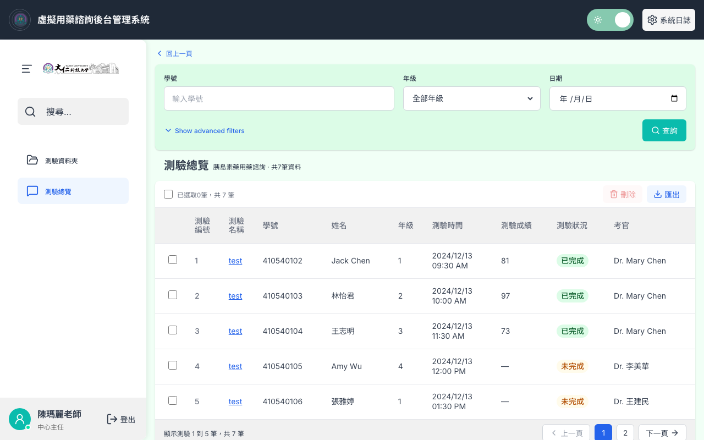
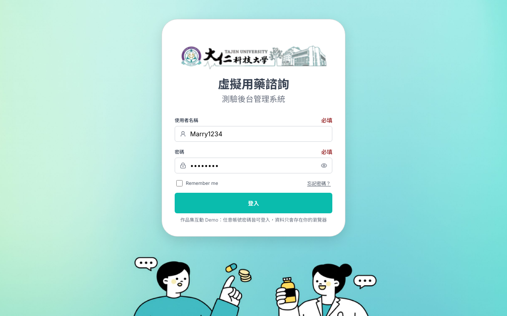
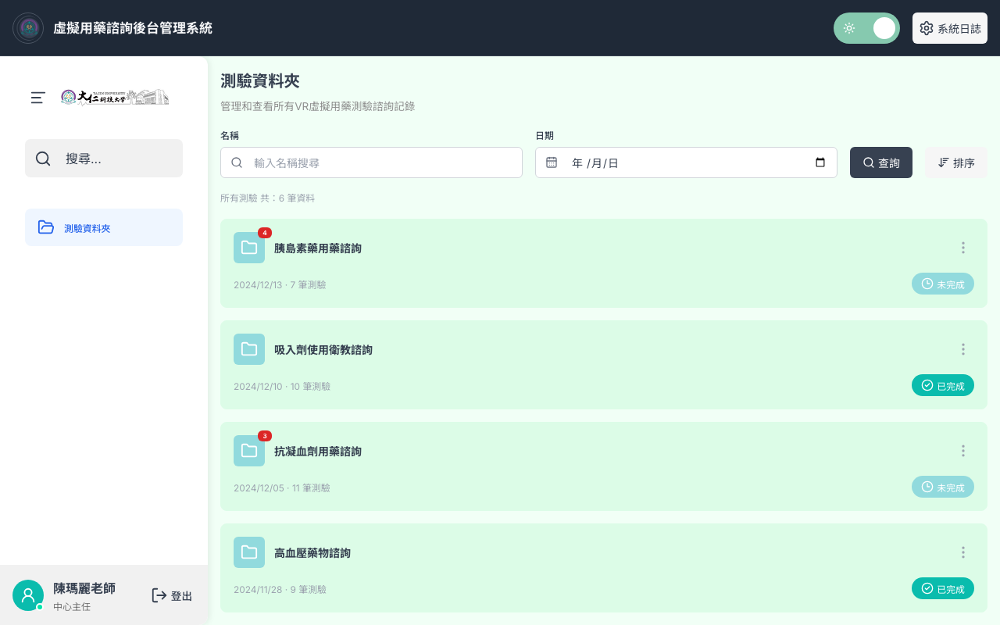
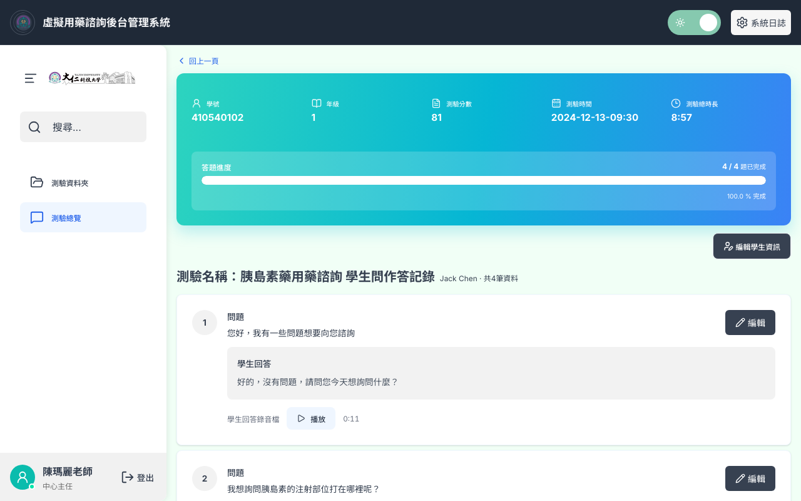
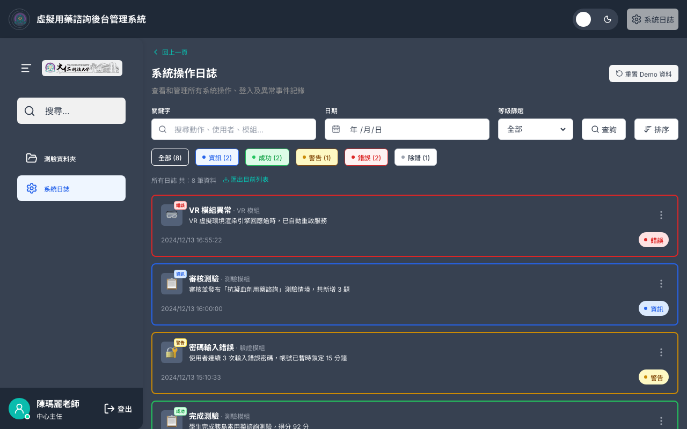

# 虛擬用藥諮詢 — 測驗後台管理系統（互動 Demo）

大仁科技大學 VR 虛擬用藥諮詢（OSCE）測驗的後台管理系統。依 Figma 設計稿實作成可實際操作的網站，作為 UI/UX 作品集的互動 Demo。

**線上 Demo：https://hr1007.github.io/vr-medication-admin/**

> 這是 Demo：登入、資料與刪除／匯出都在瀏覽器端模擬，任意帳號密碼皆可登入，資料只存在你的瀏覽器（localStorage），不會送到任何伺服器。系統日誌頁右上角可「重置 Demo 資料」。



## 功能

| 頁面 | 內容 |
|---|---|
| 登入／忘記密碼 | Remember me、登入中狀態與卡片離場轉場；忘記密碼五步驟（信箱 → 5 位數驗證碼 → 驗證成功 → 新密碼 → 完成） |
| 測驗資料夾 | 名稱／日期查詢、排序、未完成筆數徽章；刪除（紅色刪除列動畫）、匯出 CSV（確認 → 進度條 → 完成） |
| 測驗總覽 | 學號／年級／日期與進階篩選、勾選與本頁全選、批次刪除／匯出、分頁 |
| 學生作答記錄 | 漸層摘要卡與答題進度、逐題作答卡、錄音播放（瀏覽器語音朗讀）、編輯學生資訊（含學號候選清單與驗證） |
| 系統操作日誌 | 依等級上色的日誌卡、等級快速篩選籤、關鍵字／日期篩選；所有操作（登入、刪除、匯出、編輯）都會寫入日誌 |
| 全站 | 亮／暗色主題、可收合側欄（手機為覆蓋式）、對話框焦點鎖定與 Esc 關閉 |

| | |
|---|---|
|  |  |
|  |  |

## 技術

- Vite + React + TypeScript，`react-router` HashRouter（GitHub Pages 沒有 SPA fallback，hash 路由讓重新整理不會 404）
- 純 CSS + `src/styles/tokens.css`：色彩取自 Figma「Medical collection」變數，亮／暗色以 `data-theme` 切換
- Demo 資料以固定亂數種子產生（`src/data/seed.ts`），每次重置都一致
- 圖示：lucide-react

## 開發

```bash
npm install
npm run dev      # 本機預覽
npm run build    # 型別檢查 + 打包到 dist/
npm run deploy   # build 後推到 gh-pages 分支，GitHub Pages 從該分支提供網站
```
